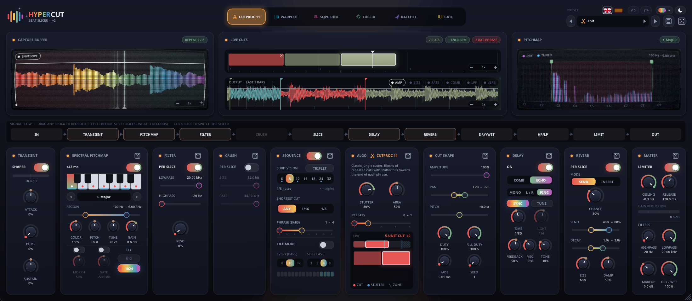
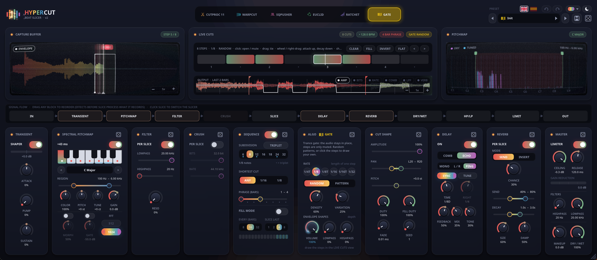

<p align="center">
  
</p>

<p align="center">
  <b>Real-time audio slicer, spectral pitchmapping and trance gate runnig inside a complex sequencer</b><br>
  <p align="center">
  VST3 · CLAP · LV2 · VST2 · JACK standalone
  </p>
</p>

<p align="center">
  <a href="https://github.com/hexamorphical/hypercut/releases"></a>
  <a href="LICENSE"></a>
  
  
</p>



HyperCut listens to your audio and cuts it up live, in time with your DAW: stutters, rolls, jungle-style rearranges,
euclidean retriggers, ratchet build-ups and a drawable trance gate. A chain of slice-aware effects follows it. It is
free software under the GNU GPL.

> **v0.1 beta.** The Linux x86_64 build is the one in daily use. macOS and Windows should build from the same source
> (see [Building](#building)), but no binaries are provided for them yet and they have not been tested.

## Contents

- [Where it comes from: BBCut → Livecut → HyperCut](#where-it-comes-from-bbcut--livecut--hypercut)
- [Download and install](#download-and-install)
- [Features](#features)
- [Opening LiveCut projects](#opening-livecut-projects)
- [Building](#building)
- [License](#license)
- [Credits](#credits)

## Where it comes from: BBCut → Livecut → HyperCut

HyperCut is a fork of **Livecut**, and Livecut itself comes from **BBCut**.

1. **BBCut** — the *BreakBeat Cutting* library by **Nick Collins** for
   [SuperCollider](https://supercollider.github.io). It began as an algorithm that simulates the way breakbeats were
   cut up by hand in early jungle and drum & bass, and grew into a whole library of algorithmic cutting procedures.
2. **[Livecut](https://github.com/mdsp/Livecut)** — a VST plugin by **Remy Muller** (mdsp @ smartelectronix, 2004)
   that brought a small subset of BBCut to any DAW. Instead of chopping audio into equal pieces like most beat slicers,
   it works with *cuts*: their length and how often they repeat depend on the context and on the cutting procedure.
   Cuts are grouped into *blocks*, blocks form a *phrase*, and a phrase can end with a roll or a fill.
3. **[LiveCut (DPF port)](https://github.com/eventual-recluse/LiveCut)** — **eventual-recluse** ported Livecut to the
   [DISTRHO Plugin Framework](https://github.com/DISTRHO/DPF) with a Dear ImGui interface, so it runs as LV2, VST2,
   VST3, CLAP and JACK on Linux, Windows and macOS.
4. **HyperCut** (this repository) — a fork of that port by **hexamorphical**. The cutting engine and its three original
   algorithms are kept, and almost everything around them is new: three more algorithms, a trance gate, seven effects,
   real-time visualisers and a redesigned interface.

The full git history of Livecut and the DPF port is kept in this repository.

## Download and install

Get the latest build from the [Releases page](https://github.com/hexamorphical/hypercut/releases) and unzip the format
your DAW uses into its folder:

| Format | Linux folder |
| --- | --- |
| VST3 (`HyperCut.vst3`, a folder) | `~/.vst3/` |
| CLAP (`HyperCut.clap`) | `~/.clap/` |
| LV2 (`HyperCut.lv2`, a folder) | `~/.lv2/` |
| VST2 (`HyperCut-vst.so`) | `~/.vst/` |
| Standalone (`HyperCut`) | anywhere; it runs as a JACK client (PipeWire: `pw-jack ./HyperCut`) |

Then rescan plugins in your DAW. HyperCut is an effect: put it on an audio track (drums and loops are the classic
source) and press play. It follows the host's tempo and time signature.

The plugin needs OpenGL and X11, which are on every desktop Linux system.

## Features

### Slicing algorithms

Six algorithms, picked with the buttons at the top. The ALGO panel shows only the controls of the selected one.

- **CutProc 11** *(original)* — the classic jungle cutter: blocks of repeated cuts, with stutters toward the end of each
  phrase (*Stutter*, *Area*).
- **WarpCut** *(original)* — accelerating and decelerating rolls (*Straight*, *Regular*, *Ritard*, *Speed*).
- **SQPusher** *(original)* — busy, Squarepusher-style edits (*Activity*).
- **Euclid** *(new)* — each half or whole bar is retriggered on a euclidean rhythm E(k, n), such as 3-3-2. *Density*
  sets the hits, *Chance* how often a block is cut, and *Slice* which hit's audio is replayed. The last bar of a phrase
  gets busier.
- **Ratchet** *(new)* — build-up rolls: retriggers per beat (1 to 16) grow over the phrase. *Intensity* sets the peak,
  *Curve* whether the build comes early or late. Pitch and pan ranges turn into a riser and a ping-pong.
- **Gate** *(new)* — a trance gate, described below.

### Trance gate



The gate never rearranges anything: the audio plays in place and steps are only muted.

- **One fixed one-bar step sequencer** in the LIVE CUTS view, up to 32 steps. **RATE** sets the step length: 1/4T,
  1/8, 1/8T, 1/16, 1/16T or 1/32.
- **Draw your own pattern**:
  - Click a step to open or mute it.
  - Drag across steps to paint them. Painted steps are **tied**: they play as one slice and are drawn as one gradient
    with no gaps.
  - CLEAR, FILL, INVERT, FLAT and the `<` `>` shift buttons edit the whole bar.
  - Drawing switches the gate from **RANDOM** to **PATTERN**.
- **Random mode**: *Density* sets how many steps play (on-beat steps first); *Variation* re-rolls part of the bar every
  bar.
- **Per-step envelopes**:
  - Mouse wheel up adds attack and wheel down adds decay; right-drag up and down does the same.
  - Shift-drag morphs the curve tension continuously, from logarithmic through linear to exponential, like DAW
    automation curves.
- **The envelope modulates more than volume**: **VOLUME**, **LOWPASS** and **HIGHPASS** depth knobs let each step's
  envelope open and close a filter as well as the level. Each knob shows its modulation range as a glowing band and
  the live value as a moving ring.

### Effects

Every effect has an on/off switch, its own dice and a place in the signal flow. Most of them draw new random settings
for every slice, inside min/max ranges you set.

- **Transient shaper** — *Attack* boosts or cuts each hit, *Pump* dips the level just after it, *Sustain* shapes the
  tail. No latency, with a gain-change meter.
- **Spectral pitchmap** — pulls the sound onto a key and scale (24 scales and chords). Inside the active region
  (100 Hz – 6 kHz by default), partials that are off the scale move to the nearest scale note, and in-key material is
  left alone.
  - **Color** sets the amount; above 100 % it adds in-key resonators that ring longer.
  - **Pitch** shifts the region in semitones, **Tune** moves the note grid in cents, **Gain** sets its level.
  - Spectral **Morph** and **Gate** shorten the ringing.
  - It runs on a phase vocoder; its latency is reported to the host.
- **Filter** — per-slice 12 dB/oct lowpass and highpass with resonance. Every block glides between random cutoffs.
- **Crush** — per-slice bit depth and sample-rate reduction.
- **Delay**, in two modes, both with **TUNE**:
  - **COMB** — the original per-slice comb (feed-forward or feedback).
  - **ECHO** — a stereo echo with long times:
    - **SYNC** note values from 1/32 to 2 bars, dotted and triplet included, or free times from 1 ms to 4 s.
    - **MONO**, **L / R** (its own time per side) or **PING**-pong.
    - Feedback, **Mix** and **Tone** (each repeat darker).
    - Time changes glide like tape; high feedback saturates softly instead of running away.
  - **TUNE** snaps the delay times to notes (delay time = 1 / pitch), so a comb or a short echo with feedback rings in
    key. The notes come from the spectral pitchmap's key and scale, which acts as the global scale even while the
    pitchmap is switched off.
- **Reverb** — per-slice reverb throws: each slice rolls a *Chance* to be sent, with a random send level and decay.
  **Send** mode lets tails ring over the next slices; **Insert** mode cuts them with each new slice.

### Sequencing

- **Subdivision** with a triplet switch, following the host's time signature.
- **Shortest cut** (*Any / 1/16 / 1/8*) merges machine-gun repeats into longer ones while staying on the grid.
- **Fill mode**: slice only during the last 1, 2, 4 or 8 bars of every 8, 16 or 32 bars, and play the dry signal the
  rest of the time.
- **Slicer on/off**, so the effects can also be used on their own.

### Master

- Dry/Wet.
- Highpass and lowpass.
- A lookahead **limiter** with ceiling, release and a gain-reduction meter.
- **Makeup** gain.

### Signal flow

The ribbon under the visualisers shows the whole chain. **Drag any block, the slicer included, to reorder it.**
Effects in front of SLICE process what the slicer records; the ones after it process its output.

### Visualisers

- **Capture buffer**: the audio recorded for the current block, with record and play heads and the current cut's
  envelope, on a CRT-style screen.
- **Live cuts**: a phrase map of every block and cut as it is chosen, above a scrolling output waveform. The waveform
  can show **AMP**, **BITS**, **RATE**, **COMB**, **LPF** and **VERB** lanes.
- **Pitchmap analyzer**: what the region holds (DRY) and where the sound was moved (TUNED). Drag its edges to set the
  region.
- **Algorithm monitor**: what the algorithm decided for each block, live (*3-UNIT CUT x2*, *E(5,8) ROT 2*,
  *ACCEL ROLL x16*, and so on).
- Every view zooms (wheel, Shift+wheel) and pans.

### Interface

- **16 colour themes** (Spectrum, Sunset, Twilight, Nebula, Lagoon, Amber and more), each in dark and light mode,
  plus switchable CRT screens.
- **English and Spanish**, switched with the flag buttons at the top. On Linux the first start follows your system
  language.
- **Logo sparks**: every chop throws glowing sparks out of the HyperCut logo, faster as the cutting speeds up.
- **Presets**: a browser that slides out on the right, with 31 factory presets (8 of them by hexamorphical, such as
  *Lush Pad Gater*, *Skrill Vocals* and *Instant Colorbass*) and your own. Sort by name, author or category, search,
  save, and see unsaved changes. A preset you save under a factory preset's name takes its place in the list.
- **Undo / redo** (Ctrl+Z / Ctrl+Shift+Z) for every edit, preset load and dice roll.
- **Dice**: the big die randomizes the whole patch within musical ranges; each panel's small die randomizes just that
  panel.
- **Range sliders** for every min/max pair, and knobs with Shift for fine control, the wheel, and double-click to reset.
- **Resizable**: the layout scales and the fonts are re-rendered sharply at any size.
- Your theme, language and window size are saved per user in `~/.config/HyperCut/ui.conf`
  (`%APPDATA%\HyperCut` on Windows, `~/Library/Preferences/HyperCut` on macOS).

## Opening LiveCut projects

HyperCut has its own plugin name and ID, so your DAW lists it as a new plugin next to LiveCut. Every original
parameter keeps its name, symbol, index and VST3 ID, so settings and automation can be moved over. Every parameter
added since then starts neutral, so a moved project sounds the same. The one exception is the effect order: projects
that never stored one get the new default (filter and crusher in front of the slicer). Drag SLICE back to the front to
get the old order.

New parameters are only ever added at the end of the list, so projects saved with this beta keep working in later
versions.

## Building

The LV2, VST2, VST3 and CLAP plugins and the JACK standalone are built by default. Remove the `TARGETS +=` lines you
don't need from `plugins/LiveCut/Makefile`. After building, everything is in the `bin` folder.

### Linux (Debian / Ubuntu)

```sh
sudo apt-get install build-essential git pkg-config freeglut3-dev
git clone --recursive https://github.com/hexamorphical/hypercut.git
cd hypercut
make
```

On Arch-based systems install `base-devel git pkgconf freeglut` instead. To install the VST3 and CLAP for your user:

```sh
mkdir -p ~/.vst3 ~/.clap
cp -r bin/HyperCut.vst3 ~/.vst3/
cp bin/HyperCut.clap ~/.clap/
```

### Windows 10/11 64-bit (untested)

Install [MSYS2](https://www.msys2.org/), open the MinGW64 shell, then:

```sh
pacman -S base-devel git mingw-w64-x86_64-gcc mingw-w64-x86_64-freeglut
git clone --recursive https://github.com/hexamorphical/hypercut.git
cd hypercut
make -f Makefile-windows
```

### macOS (untested)

```sh
xcode-select --install
git clone --recursive https://github.com/hexamorphical/hypercut.git
cd hypercut
make
```

## License

HyperCut is free software, released under the **[GNU General Public License, version 3](LICENSE)** (GPL-3.0).

This means that you may:

- use it for anything, including commercial music;
- study and change the source code;
- share copies, changed or not.

The condition is that anything you distribute that is based on HyperCut must also be released under the GPL, with
its source code available, so it stays free for everyone. HyperCut comes **without any warranty**; see the
[license](LICENSE) for the full terms.

The original Livecut is © 2003–2004 Remy Muller and was released under the GPL version 2 *or (at your option) any
later version* (see [ORIGINAL_LIVECUT_LICENSE.md](ORIGINAL_LIVECUT_LICENSE.md)). That is what allows the DPF port, and
HyperCut, to be distributed under version 3. The libraries it uses keep their own licenses, listed below.

## Credits

- **BBCut** by Nick Collins, the algorithmic breakbeat cutting library for SuperCollider that started it all.
- **[Livecut](https://github.com/mdsp/Livecut)** by Remy Muller (mdsp @ smartelectronix), GPL.
- **[LiveCut DPF port](https://github.com/eventual-recluse/LiveCut)** by eventual-recluse, GPL-3.0.
- **HyperCut** by hexamorphical.
- **[DISTRHO Plugin Framework](https://github.com/DISTRHO/DPF)**, ISC license.
- **[Dear ImGui](https://github.com/ocornut/imgui)**, MIT license.
- **[Noto Sans](https://fonts.google.com/noto/specimen/Noto+Sans)** by the Noto Project Authors (embedded as a Latin
  subset), [SIL Open Font License](https://openfontlicense.org).
- State-variable filter based on the work of Andrew Simper ([Cytomic](https://cytomic.com/technical-papers/)).
- The spectral pitchmap was inspired by Xynth Audio's Chroma.
